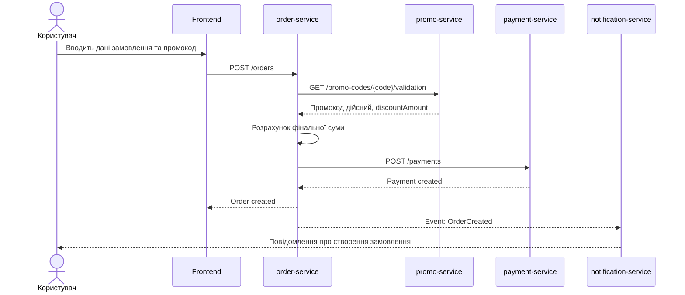
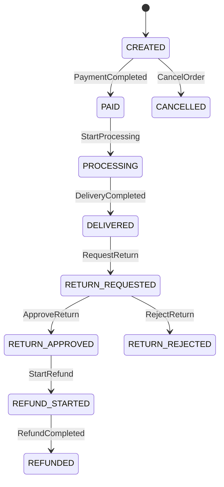

# Лабораторна робота 3

## Опис контрактів і сценаріїв взаємодії мікросервісної системи

---

## 1. Мета роботи

Метою лабораторної роботи є формалізація взаємодій у мікросервісній системі через опис бізнес-сценаріїв, API-контрактів, подій, станів ключових сутностей і зв’язку цих артефактів із обраною зміною системи.

У лабораторних роботах 1–2 студенти вже описали предметну область, визначили сервіси, класифікували можливі зміни, оцінили якість архітектури та зафіксували baseline-архітектуру. У лабораторній роботі 3 основна увага переноситься з опису структури системи на **опис поведінки системи та контрактів взаємодії між сервісами**.

Після виконання лабораторної роботи студенти повинні вміти:

- описувати AS-IS та TO-BE сценарії роботи мікросервісної системи;
- визначати, які сервіси беруть участь у бізнес-процесі;
- формалізувати REST API-контракти за допомогою OpenAPI;
- описувати event-контракти для асинхронної взаємодії;
- будувати sequence diagram для сценаріїв взаємодії;
- описувати стани ключової бізнес-сутності;
- визначати, які контракти можуть бути зачеплені обраною зміною;
- відрізняти сумісні та несумісні зміни контрактів;
- готувати контрактну модель системи для подальшого графового аналізу та аналізу впливу змін.

---

## 2. Вхідні умови

Бригада студентів складається з **3 осіб**.

На початку лабораторної роботи бригада повинна мати результати лабораторної роботи 2:

- зафіксовану baseline-архітектуру системи;
- список сервісів;
- опис відповідальності сервісів;
- опис власників даних;
- матрицю залежностей між сервісами;
- опис архітектурних проблем або антипатернів;
- обрану наскрізну зміну, яка буде досліджуватися у наступних лабораторних роботах;
- файл `architecture.yaml` або `architecture.json`, якщо він був підготовлений у лабораторній роботі 2.

У межах цієї лабораторної роботи **не потрібно реалізовувати повноцінний програмний код сервісів**. Основне завдання — описати сценарії взаємодії та формалізувати контракти.

Проте студенти повинні підготувати такі структуровані артефакти:

- опис AS-IS сценарію;
- опис TO-BE сценарію;
- sequence diagram;
- OpenAPI-опис для ключових REST API;
- event-контракти;
- опис станів або зміни станів ключової сутності;
- таблицю зв’язку між бізнес-сценарієм, сервісами, API, подіями, даними та ризиками.

---

## 3. Головна ідея лабораторної роботи

У попередніх лабораторних роботах студенти відповідали на питання:

> З яких сервісів складається система?
>
> Наскільки якісно вона декомпозована?
>
> Яку baseline-архітектуру ми приймаємо для подальшого аналізу?

У цій лабораторній роботі потрібно відповісти на інші питання:

> Як саме сервіси взаємодіють під час виконання бізнес-сценарію?
>
> Які API, події та дані забезпечують цю взаємодію?
>
> Що зміниться у сценарії після внесення обраної зміни?
>
> Які контракти можуть стати небезпечними точками зміни?

Важливо: ця лабораторна робота не повинна перетворюватися лише на опис OpenAPI. OpenAPI є важливим інструментом, але в межах дисципліни **«Інженерія змін у мікросервісних системах»** центральним об’єктом є не тільки API, а **інженерна зміна**.

Тому зміна може бути:

- API-орієнтованою;
- процесною;
- подієвою;
- пов’язаною з даними;
- інтеграційною;
- архітектурною.

Якщо обрана зміна майже не змінює API, студенти все одно повинні описати бізнес-сценарій, події, стани, affected services і ризики. Якщо зміна є невеликою в API, але значною в бізнес-процесі, основний акцент має бути зроблений саме на процесі та його наслідках.

---

## 4. Ролі в бригаді

Оскільки робота виконується бригадою з 3 осіб, рекомендовано розподілити ролі.

### Студент 1 — аналітик бізнес-сценарію

Відповідає за:

- опис AS-IS сценарію;
- опис TO-BE сценарію;
- визначення учасників процесу;
- опис основних кроків бізнес-процесу;
- побудову або підготовку sequence diagram;
- пояснення, як обрана зміна змінює поведінку системи.

### Студент 2 — аналітик API-контрактів

Відповідає за:

- визначення REST API, які беруть участь у сценарії;
- підготовку OpenAPI-опису;
- опис endpoint-ів, request/response моделей, кодів помилок;
- визначення потенційно сумісних і несумісних API-змін;
- перевірку узгодженості API-контрактів із sequence diagram.

### Студент 3 — аналітик подій, станів і ризиків

Відповідає за:

- опис event-контрактів;
- визначення producer та consumer для кожної події;
- опис станів ключової сутності;
- виявлення ризиків зміни контрактів;
- підготовку traceability matrix;
- оновлення `architecture.yaml` або підготовку додаткового файлу `contracts.yaml`.

Ролі є рекомендованими. У звіті потрібно зазначити, хто за яку частину відповідав.

---

## 5. Рекомендовані безкоштовні інструменти

Для виконання лабораторної роботи можна використовувати такі безкоштовні інструменти:

- **Swagger Editor** — для перевірки OpenAPI-опису;
- **Swagger UI** — для візуалізації API-документації;
- **Redocly CLI** — для локальної перевірки OpenAPI-файлів;
- **Stoplight Elements** — для перегляду OpenAPI-документації;
- **Mermaid** — для sequence diagram та state diagram;
- **PlantUML** — для діаграм взаємодії;
- **diagrams.net** — для ручних схем;
- **GitHub / GitLab** — для зберігання артефактів;
- **VS Code** — для редагування YAML/Markdown;
- **Docker Compose** — за бажанням, якщо бригада хоче продемонструвати mock-сервіси.

Використання платних інструментів не вимагається.

---

## 6. Завдання лабораторної роботи

### Завдання 1. Уточнити тип обраної зміни

Бригада повинна повернутися до зміни, яку було обрано в лабораторній роботі 1, і уточнити її тип.

Потрібно визначити, до якої категорії належить зміна:

- зміна бізнес-процесу;
- зміна API;
- зміна структури даних;
- додавання нового сервісу;
- зміна взаємодії між сервісами;
- зміна подій;
- зміна інтеграції із зовнішньою системою;
- зміна правил безпеки;
- зміна вимог до продуктивності;
- комбінована зміна.

Зміна може належати до кількох категорій одночасно.

Наприклад, зміна **«додати процес повернення товару»** є не просто API-зміною. Вона може включати:

- новий бізнес-процес;
- нову сутність `Return`;
- нові стани повернення;
- нові API endpoint-и;
- нові події;
- вплив на оплату, склад, доставку та сповіщення.

Зміна **«додати промокоди»** може включати:

- зміну бізнес-логіки розрахунку вартості;
- зміну API створення замовлення;
- нові дані про промокоди;
- вплив на оплату;
- вплив на події замовлення.

**Результат завдання:**

- назва обраної зміни;
- короткий опис зміни;
- тип або типи зміни;
- пояснення, чому зміна є достатньо суттєвою для подальшого аналізу.

#### Шаблон опису типу зміни

| Поле | Значення |
|---|---|
| Назва зміни |  |
| Короткий опис |  |
| Основний тип зміни |  |
| Додаткові типи зміни |  |
| Чи зачіпає бізнес-процес | так / ні |
| Чи зачіпає API | так / ні |
| Чи зачіпає події | так / ні |
| Чи зачіпає дані | так / ні |
| Чи зачіпає кілька сервісів | так / ні |
| Попередній рівень ризику | низький / середній / високий |

---

### Завдання 2. Описати AS-IS сценарій роботи системи

Потрібно описати, як відповідний бізнес-сценарій працює **до внесення зміни**.

AS-IS сценарій має показати поточну поведінку системи в межах baseline-архітектури.

Потрібно визначити:

- хто ініціює сценарій;
- які сервіси беруть участь;
- які API викликаються;
- які події створюються;
- які дані читаються або змінюються;
- які стани проходить ключова сутність;
- де сценарій завершується успішно;
- які помилки або альтернативні гілки можуть виникати.

Наприклад, для сценарію створення замовлення AS-IS може виглядати так:

1. Користувач відкриває кошик.
2. Frontend надсилає запит до `cart-service`.
3. `cart-service` повертає список товарів.
4. Frontend надсилає запит на створення замовлення до `order-service`.
5. `order-service` перевіряє користувача через `user-service`.
6. `order-service` перевіряє товари через `catalog-service`.
7. `order-service` створює замовлення у статусі `CREATED`.
8. `order-service` викликає `payment-service`.
9. `payment-service` створює платіж.
10. Після успішної оплати створюється подія `PaymentCompleted`.
11. `order-service` оновлює статус замовлення.
12. `notification-service` надсилає повідомлення користувачу.

**Результат завдання:**

- текстовий опис AS-IS сценарію;
- список сервісів, які беруть участь;
- список API та подій, які використовуються;
- перелік ключових даних або станів.

#### Шаблон AS-IS сценарію

| Крок | Учасник / сервіс | Дія | API / подія | Дані | Результат |
|---:|---|---|---|---|---|
| 1 |  |  |  |  |  |
| 2 |  |  |  |  |  |
| 3 |  |  |  |  |  |

---

### Завдання 3. Описати TO-BE сценарій після внесення зміни

Потрібно описати, як сценарій має працювати **після внесення обраної зміни**.

TO-BE сценарій має показати нову або змінену поведінку системи.

Потрібно визначити:

- які кроки залишаються без змін;
- які кроки додаються;
- які кроки змінюються;
- які кроки видаляються;
- які сервіси отримують нову відповідальність;
- чи потрібно додавати новий сервіс;
- чи змінюються API endpoint-и;
- чи з’являються нові події;
- чи змінюються стани ключової сутності;
- які нові помилки можуть виникати.

Наприклад, для зміни **«додати промокоди»** TO-BE сценарій може містити нові кроки:

- користувач вводить промокод;
- `order-service` передає промокод до `promo-service` або перевіряє його самостійно;
- `promo-service` перевіряє строк дії промокоду;
- система розраховує знижку;
- у відповіді API з’являється `discountAmount`;
- у події `OrderCreated` може з’явитися інформація про знижку;
- `payment-service` отримує вже скориговану суму оплати.

Для зміни **«додати процес повернення товару»** TO-BE сценарій може містити новий процес:

- користувач створює заявку на повернення;
- `return-service` перевіряє можливість повернення;
- `order-service` підтверджує, що замовлення завершене;
- `delivery-service` створює завдання на зворотну доставку;
- `payment-service` запускає повернення коштів;
- `notification-service` повідомляє користувача;
- змінюються стани сутності `Return`.

**Результат завдання:**

- текстовий опис TO-BE сценарію;
- список нових або змінених кроків;
- список нових або змінених API;
- список нових або змінених подій;
- список нових або змінених станів.

#### Шаблон порівняння AS-IS і TO-BE

| Елемент | AS-IS | TO-BE | Тип зміни |
|---|---|---|---|
| Бізнес-крок |  |  | додано / змінено / видалено |
| Сервіс |  |  | додано / змінено / без змін |
| API |  |  | додано / змінено / без змін |
| Подія |  |  | додано / змінено / без змін |
| Дані |  |  | додано / змінено / без змін |
| Стан сутності |  |  | додано / змінено / без змін |

---

### Завдання 4. Побудувати sequence diagram для сценарію взаємодії

Потрібно побудувати sequence diagram, який показує взаємодію між учасниками сценарію.

Діаграма має містити:

- користувача або зовнішнього клієнта;
- frontend або API Gateway, якщо він є в архітектурі;
- основні мікросервіси;
- зовнішні системи, якщо вони беруть участь;
- REST API-виклики;
- асинхронні події;
- відповіді сервісів;
- альтернативні гілки або помилки, якщо вони суттєві для зміни.

Можна побудувати одну TO-BE діаграму або дві діаграми:

- AS-IS sequence diagram;
- TO-BE sequence diagram.

Якщо зміна суттєво змінює процес, краще зробити обидві діаграми.

#### Приклад sequence diagram у Mermaid



**Результат завдання:**

- sequence diagram у Mermaid, PlantUML або іншому форматі;
- коротке пояснення діаграми;
- позначення нових або змінених взаємодій.

---

### Завдання 5. Описати REST API-контракти за допомогою OpenAPI

Потрібно підготувати OpenAPI-опис для ключових REST API, які беруть участь у вибраному сценарії або можуть бути зачеплені обраною зміною.

Не потрібно описувати весь API всієї системи. Потрібно описати **лише ті endpoint-и, які важливі для обраного сценарію та зміни**.

Мінімальні вимоги:

- описати API щонайменше для **одного сервісу**;
- описати щонайменше **2 endpoint-и**;
- використати структуру `openapi`, `info`, `servers`, `paths`, `components.schemas`;
- описати request body;
- описати responses;
- описати щонайменше 2 коди помилок;
- додати приклади request/response;
- вказати, які поля або endpoint-и можуть бути змінені внаслідок обраної зміни.

Для сильніших бригад рекомендовано описати:

- API для 2 сервісів;
- 3–5 endpoint-ів;
- окремі DTO для request та response;
- enum-значення статусів;
- помилки бізнес-логіки;
- версії API.

#### Мінімальний приклад OpenAPI

```yaml
openapi: 3.1.0
info:
  title: Order Service API
  version: 1.0.0
  description: API для створення та перегляду замовлень.

servers:
  - url: http://localhost:8080
    description: Local environment

paths:
  /orders:
    post:
      summary: Create order
      description: Створює нове замовлення користувача.
      operationId: createOrder
      requestBody:
        required: true
        content:
          application/json:
            schema:
              $ref: '#/components/schemas/CreateOrderRequest'
            examples:
              basic:
                value:
                  userId: "user-123"
                  items:
                    - productId: "product-1"
                      quantity: 2
                  promoCode: "SALE10"
      responses:
        '201':
          description: Order created
          content:
            application/json:
              schema:
                $ref: '#/components/schemas/OrderResponse'
              examples:
                created:
                  value:
                    orderId: "order-456"
                    status: "CREATED"
                    totalAmount: 900.0
                    discountAmount: 100.0
                    currency: "UAH"
        '400':
          description: Invalid request
          content:
            application/json:
              schema:
                $ref: '#/components/schemas/ErrorResponse'
        '409':
          description: Business conflict
          content:
            application/json:
              schema:
                $ref: '#/components/schemas/ErrorResponse'

  /orders/{orderId}:
    get:
      summary: Get order by id
      description: Повертає інформацію про замовлення.
      operationId: getOrderById
      parameters:
        - name: orderId
          in: path
          required: true
          schema:
            type: string
      responses:
        '200':
          description: Order found
          content:
            application/json:
              schema:
                $ref: '#/components/schemas/OrderResponse'
        '404':
          description: Order not found
          content:
            application/json:
              schema:
                $ref: '#/components/schemas/ErrorResponse'

components:
  schemas:
    CreateOrderRequest:
      type: object
      required:
        - userId
        - items
      properties:
        userId:
          type: string
          example: "user-123"
        items:
          type: array
          items:
            $ref: '#/components/schemas/OrderItemRequest'
        promoCode:
          type: string
          nullable: true
          example: "SALE10"

    OrderItemRequest:
      type: object
      required:
        - productId
        - quantity
      properties:
        productId:
          type: string
        quantity:
          type: integer
          minimum: 1

    OrderResponse:
      type: object
      properties:
        orderId:
          type: string
        status:
          type: string
          enum:
            - CREATED
            - PAID
            - CANCELLED
        totalAmount:
          type: number
          format: double
        discountAmount:
          type: number
          format: double
        currency:
          type: string
          example: "UAH"

    ErrorResponse:
      type: object
      properties:
        code:
          type: string
          example: "PROMO_CODE_EXPIRED"
        message:
          type: string
          example: "Promo code is expired"
```

**Результат завдання:**

- файл `openapi.yaml`;
- короткий опис endpoint-ів;
- пояснення, які частини API пов’язані з обраною зміною;
- перелік потенційних сумісних і несумісних змін API.

---

### Завдання 6. Описати event-контракти

Якщо в системі є асинхронна взаємодія, потрібно описати event-контракти. Якщо бригада вважає, що в її системі немає подій, вона повинна обґрунтувати це рішення та описати хоча б одну потенційну подію, яку можна було б використати для зменшення синхронного зчеплення.

Потрібно описати щонайменше **2 події** або асинхронні повідомлення.

Для кожної події потрібно вказати:

- назву події;
- версію;
- producer;
- consumers;
- коли подія створюється;
- payload;
- ключові поля;
- чи є подія частиною AS-IS або TO-BE сценарію;
- чи змінюється подія внаслідок обраної зміни;
- які ризики виникають для споживачів події.

#### Приклад event-контракту

```yaml
events:
  - name: OrderCreated
    version: "1.0"
    producer: order-service
    consumers:
      - notification-service
      - delivery-service
    produced_when: "Замовлення створено та збережено в order-service"
    payload:
      orderId: string
      userId: string
      totalAmount: number
      discountAmount: number
      currency: string
      createdAt: string
    example:
      orderId: "order-456"
      userId: "user-123"
      totalAmount: 900.0
      discountAmount: 100.0
      currency: "UAH"
      createdAt: "2026-09-15T10:00:00Z"
    change_impact:
      affected_by_selected_change: true
      reason: "Після додавання промокодів у події може зʼявитися discountAmount"
      compatibility: "потенційно сумісна зміна, якщо поле необовʼязкове"
```

#### Шаблон опису події

| Поле | Опис |
|---|---|
| Назва події |  |
| Версія |  |
| Producer |  |
| Consumers |  |
| Коли створюється |  |
| Основні поля payload |  |
| AS-IS / TO-BE |  |
| Чи змінюється через обрану зміну | так / ні |
| Ризик для consumer-ів | низький / середній / високий |

**Результат завдання:**

- опис мінімум 2 event-контрактів;
- пояснення producer/consumer-зв’язків;
- оцінка ризику зміни подій.

---

### Завдання 7. Описати стани ключової бізнес-сутності

Для обраного сценарію потрібно визначити ключову бізнес-сутність і описати її стани.

Приклади ключових сутностей:

- `Order` для сценарію створення або зміни замовлення;
- `Payment` для сценарію оплати;
- `Return` для сценарію повернення товару;
- `Booking` для сценарію бронювання;
- `Ticket` для системи підтримки клієнтів;
- `Delivery` для сценарію доставки;
- `Subscription` для сценарію підписки.

Потрібно описати:

- назву сутності;
- сервіс-власник сутності;
- основні поля;
- можливі стани;
- переходи між станами;
- які API або події змінюють стан;
- які нові стани з’являються після внесення зміни.

#### Приклад state diagram у Mermaid



#### Шаблон опису станів

| Стан | Опис | Хто встановлює | API / подія | Наступні можливі стани |
|---|---|---|---|---|
| CREATED |  |  |  |  |
| PAID |  |  |  |  |
| CANCELLED |  |  |  |  |

**Результат завдання:**

- опис ключової сутності;
- таблиця станів;
- state diagram або текстовий опис переходів;
- пояснення, як обрана зміна впливає на стани.

---

### Завдання 8. Визначити сумісність і небезпечні зміни контрактів

Потрібно проаналізувати, чи запропоновані зміни контрактів є сумісними зі старими клієнтами або споживачами.

Потрібно розглянути окремо:

- REST API;
- event-контракти;
- структуру даних;
- стани бізнес-сутності;
- sequence diagram або бізнес-сценарій.

Приклади відносно безпечних змін API:

- додати необов’язкове поле у відповідь;
- додати новий endpoint;
- додати новий необов’язковий query-параметр;
- розширити enum, якщо клієнти коректно обробляють невідомі значення;
- додати новий код помилки, якщо клієнт має загальну обробку помилок.

Приклади небезпечних змін API:

- видалити поле з відповіді;
- перейменувати поле;
- змінити тип поля;
- зробити необов’язкове поле обов’язковим;
- змінити endpoint;
- змінити семантику існуючого поля;
- змінити формат ідентифікатора;
- змінити список можливих статусів без попередження клієнтів.

Приклади небезпечних змін подій:

- видалити поле, яке використовують consumer-и;
- перейменувати подію;
- змінити producer;
- змінити тип поля в payload;
- змінити семантику події;
- змінити момент створення події;
- об’єднати кілька подій в одну без підтримки старих consumer-ів.

#### Шаблон аналізу сумісності

| Контракт / елемент | Запропонована зміна | Тип зміни | Сумісність | Потенційно зачеплені споживачі | Рекомендація |
|---|---|---|---|---|---|
| `POST /orders` | додано `promoCode` | API | сумісна, якщо поле необов’язкове | frontend | залишити поле optional |
| `OrderCreated` | додано `discountAmount` | event | сумісна, якщо consumer-и ігнорують невідомі поля | notification-service, delivery-service | версія `1.1` або optional field |

**Результат завдання:**

- таблиця сумісності;
- список потенційно небезпечних змін;
- рекомендації щодо безпечного внесення змін.

---

### Завдання 9. Побудувати traceability matrix

Потрібно побудувати таблицю, яка зв’язує бізнес-сценарій, сервіси, API, події, дані та ризики.

Ця таблиця потрібна для наступних лабораторних робіт, особливо для:

- побудови графа залежностей;
- аналізу впливу зміни;
- визначення affected services;
- планування тестування;
- планування релізу.

#### Шаблон traceability matrix

| Крок сценарію | Сервіс | API / подія | Дані / сутність | AS-IS / TO-BE | Ризик | Коментар |
|---:|---|---|---|---|---|---|
| 1 | frontend | POST /orders | Order | TO-BE | середній | додається `promoCode` |
| 2 | order-service | GET /promo-codes/{code}/validation | PromoCode | TO-BE | високий | нова залежність від promo-service |
| 3 | payment-service | POST /payments | Payment | AS-IS/TO-BE | середній | сума платежу залежить від знижки |
| 4 | order-service | OrderCreated | Order | TO-BE | середній | подія може отримати `discountAmount` |

**Результат завдання:**

- traceability matrix;
- позначення найбільш ризикових точок сценарію;
- висновок, які елементи потрібно аналізувати в лабораторній роботі 4.

---

### Завдання 10. Підготувати файл контрактної моделі

Окрім звіту, бригада повинна підготувати машинно-читаний опис ключових контрактів.

Можна використати один із двох варіантів:

1. Оновити `architecture.yaml`, додавши розділи `apis`, `events`, `scenarios`.
2. Створити окремий файл `contracts.yaml`.

#### Приклад `contracts.yaml`

```yaml
system: online-ordering-system
version: "1.0"

selected_change:
  name: add promo codes
  type:
    - business_logic
    - api
    - data
    - event

scenarios:
  - name: create order with promo code
    type: TO-BE
    participants:
      - frontend
      - order-service
      - promo-service
      - payment-service
      - notification-service
    key_entity: Order

apis:
  - service: order-service
    method: POST
    path: /orders
    purpose: create order
    affected_by_selected_change: true
    change_reason: "request may include promoCode"

  - service: promo-service
    method: GET
    path: /promo-codes/{code}/validation
    purpose: validate promo code
    affected_by_selected_change: true
    change_reason: "new API introduced by selected change"

events:
  - name: OrderCreated
    producer: order-service
    consumers:
      - notification-service
      - delivery-service
    affected_by_selected_change: true
    change_reason: "event may include discountAmount"

data_entities:
  - name: Order
    owner: order-service
    affected_by_selected_change: true

  - name: PromoCode
    owner: promo-service
    affected_by_selected_change: true
```

**Результат завдання:**

- `openapi.yaml`;
- `contracts.yaml` або оновлений `architecture.yaml`;
- перевірена узгодженість між звітом, діаграмами й файлами.

---

## 7. Підсумковий результат лабораторної роботи

За результатами лабораторної роботи бригада повинна підготувати звіт і набір супровідних файлів.

Звіт має містити:

1. Назву бригади або номер групи.
2. Склад бригади та розподіл ролей.
3. Назву системи.
4. Назву та опис обраної зміни.
5. Тип зміни.
6. Опис AS-IS сценарію.
7. Опис TO-BE сценарію.
8. Sequence diagram.
9. Опис REST API-контрактів.
10. Посилання або вставку на `openapi.yaml`.
11. Опис event-контрактів.
12. Опис станів ключової сутності.
13. Аналіз сумісності змін контрактів.
14. Traceability matrix.
15. Висновки.

Окремими файлами потрібно здати:

- `openapi.yaml`;
- `contracts.yaml` або оновлений `architecture.yaml`;
- діаграми у форматі `.md`, `.puml`, `.drawio`, `.png` або іншому узгодженому форматі.

---

## 8. Вимоги до оформлення звіту

Звіт подається у форматі PDF або Markdown.

Рекомендований обсяг:

- 6–10 сторінок без урахування великих схем;
- або Markdown-документ обсягом приблизно 1200–2200 слів.

Обов’язково мають бути:

- структуровані розділи;
- AS-IS та TO-BE сценарії;
- sequence diagram;
- OpenAPI-приклад або посилання на `openapi.yaml`;
- опис мінімум 2 REST endpoint-ів;
- опис мінімум 2 event-контрактів або обґрунтування, чому події не використовуються;
- опис станів ключової сутності;
- traceability matrix;
- висновок щодо ризиків зміни.

Код сервісів у цій лабораторній роботі не є обов’язковим.

---

## 9. Обов’язковий мінімум, рекомендований рівень і додаткові завдання

Щоб уникнути дисбалансу складності між різними бригадами, лабораторна робота має три рівні виконання.

### 9.1. Обов’язковий мінімум

Для зарахування роботи потрібно виконати:

- описати одну обрану зміну;
- описати AS-IS сценарій;
- описати TO-BE сценарій;
- побудувати одну sequence diagram;
- описати мінімум 2 REST endpoint-и в OpenAPI;
- описати мінімум 1 event-контракт або обґрунтувати відсутність подій;
- описати стани однієї ключової сутності;
- побудувати traceability matrix.

### 9.2. Рекомендований рівень

Для повноцінного виконання роботи рекомендовано:

- описати 3–5 REST endpoint-ів;
- описати мінімум 2 event-контракти;
- зробити AS-IS і TO-BE sequence diagram окремо;
- додати приклади request/response в OpenAPI;
- описати типові помилки API;
- визначити сумісні та несумісні зміни;
- підготувати `contracts.yaml`.

### 9.3. Додаткові завдання

Для поглибленого виконання можна додатково:

- перевірити `openapi.yaml` через Swagger Editor або Redocly CLI;
- підготувати mock API на основі OpenAPI;
- описати AsyncAPI для подій;
- додати BPMN-подібну діаграму бізнес-процесу;
- описати contract testing strategy;
- додати версіонування API або подій;
- сформувати список тестів для перевірки кожного контракту.

---

## 10. Критерії оцінювання

Максимальна оцінка — **10 балів**.

| Компонент | Бали |
|---|---:|
| Уточнення типу обраної зміни | 1 |
| Опис AS-IS та TO-BE сценаріїв | 1.5 |
| Sequence diagram | 1 |
| OpenAPI-опис REST API | 1.5 |
| Event-контракти | 1 |
| Опис станів ключової сутності | 1 |
| Аналіз сумісності та небезпечних змін | 1 |
| Traceability matrix | 1 |
| Машинно-читаний опис `contracts.yaml` або оновлений `architecture.yaml` | 0.7 |
| Якість оформлення, узгодженість і висновки | 0.3 |

---

## 11. Типові помилки студентів

Під час виконання лабораторної роботи потрібно уникати таких помилок:

1. **Описано тільки API, але не описано бізнес-сценарій.**  
   API не пояснює сам по собі, навіщо відбувається взаємодія між сервісами.

2. **OpenAPI містить тільки список endpoint-ів без request/response моделей.**  
   Такий опис не є повноцінним контрактом.

3. **Не вказано помилки API.**  
   Для інженерії змін важливо розуміти не лише успішний сценарій, а й помилки.

4. **Події описано як звичайні повідомлення без producer/consumer.**  
   У мікросервісній системі потрібно знати, хто створює подію і хто від неї залежить.

5. **Немає різниці між AS-IS і TO-BE.**  
   Якщо зміна не змінює сценарій, потрібно пояснити, де саме проявляється її вплив.

6. **Не описано ключову сутність і її стани.**  
   Для процесних змін саме стани часто є основним джерелом складності.

7. **Не вказано, які контракти зачеплені зміною.**  
   Без цього неможливо перейти до аналізу впливу у наступній лабораторній.

8. **Всі зміни оголошено “безпечними” без обґрунтування.**  
   Потрібно пояснювати, чому зміна сумісна або несумісна.

9. **Діаграма не відповідає текстовому опису.**  
   Сервіси, API й події в діаграмі мають збігатися з описом у звіті.

10. **Зміна занадто мала.**  
    Якщо зміна полягає лише в додаванні одного необов’язкового поля без впливу на процес, потрібно розширити її до повноцінної бізнес-зміни.

---

## 12. Приклад формулювання завдання для студентів

**Завдання:**  
Бригада з 3 студентів повинна взяти baseline-архітектуру мікросервісної системи, сформовану в лабораторній роботі 2, і описати ключовий бізнес-сценарій, пов’язаний з обраною зміною. Необхідно підготувати AS-IS та TO-BE описи сценарію, побудувати sequence diagram, формалізувати REST API-контракти через OpenAPI, описати event-контракти, визначити стани ключової бізнес-сутності, оцінити сумісність змін контрактів і побудувати traceability matrix, яка зв’язує бізнес-кроки, сервіси, API, події, дані та ризики.

---

## 13. Що має вийти в результаті

Після виконання лабораторної роботи у студентів має бути не просто набір endpoint-ів, а **контрактно-процесна модель взаємодії мікросервісної системи**.

У результаті бригада повинна чітко розуміти:

- який бізнес-сценарій аналізується;
- як він працював до зміни;
- як він має працювати після зміни;
- які сервіси беруть участь у сценарії;
- які API використовуються;
- які події створюються;
- яка сутність змінює стани;
- які контракти є потенційно небезпечними;
- які елементи потрібно врахувати у графі залежностей;
- які елементи потрібно аналізувати в наступній лабораторній роботі.

Ця лабораторна робота створює основу для подальшого графового аналізу та impact analysis. Якщо лабораторна робота 2 фіксувала архітектуру як baseline, то лабораторна робота 3 фіксує **поведінку системи та контракти взаємодії** як основу для аналізу змін.

---

## 14. Зв’язок із наступними лабораторними роботами

Результати цієї лабораторної роботи будуть використані в наступних роботах.

У лабораторній роботі 4 вони стануть основою для побудови графа залежностей:

- сервіси стануть вузлами графа;
- REST API-виклики стануть ребрами;
- події producer-consumer стануть асинхронними ребрами;
- сутності даних можуть бути додатковими вузлами;
- зовнішні API можуть бути зовнішніми вузлами графа.

У лабораторній роботі 5 ці артефакти будуть використані для аналізу впливу зміни:

- які API зачеплені;
- які події змінюються;
- які сервіси потрібно тестувати;
- які дані потрібно мігрувати;
- які сценарії можуть зламатися.

У лабораторній роботі 6 результати будуть використані для планування реалізації, тестування, релізу та моніторингу зміни.

---

## 15. Рекомендована структура репозиторію

Бригада може оформити результати лабораторної роботи у вигляді невеликого репозиторію.

```text
lab-3-contracts-and-scenarios/
├── README.md
├── report.md
├── openapi.yaml
├── contracts.yaml
├── diagrams/
│   ├── sequence-as-is.md
│   ├── sequence-to-be.md
│   └── state-diagram.md
└── examples/
    ├── create-order-request.json
    ├── create-order-response.json
    └── order-created-event.json
```

Мінімально достатньо здати:

```text
lab-3-contracts-and-scenarios/
├── report.md
├── openapi.yaml
└── contracts.yaml
```

---

## 16. Контрольні питання

1. Чим API-контракт відрізняється від звичайного опису endpoint-а?
2. Чому для аналізу змін недостатньо описати лише сервіси?
3. Що таке AS-IS і TO-BE сценарії?
4. Чому процесна зміна може бути складною, навіть якщо API майже не змінюється?
5. Які зміни OpenAPI-контракту можна вважати сумісними?
6. Які зміни OpenAPI-контракту можуть зламати клієнтів?
7. Чому подія у мікросервісній системі також є контрактом?
8. Що може статися, якщо змінити payload події без попередження consumer-ів?
9. Для чого потрібна state diagram у процесних змінах?
10. Як traceability matrix допомагає в аналізі впливу зміни?
11. Чому потрібно зв’язувати бізнес-кроки з API, подіями та даними?
12. Як результати лабораторної роботи 3 будуть використані для побудови графа залежностей?

---

## 17. Висновок до лабораторної роботи

У висновку бригада повинна коротко відповісти на такі питання:

- яку зміну було обрано;
- який сценарій був проаналізований;
- які відмінності між AS-IS і TO-BE сценаріями;
- які API-контракти є ключовими;
- які події є ключовими;
- яка сутність має найважливіші стани;
- які контракти або стани є найбільш ризиковими;
- що потрібно врахувати в наступній лабораторній роботі.

Приклад висновку:

> У межах лабораторної роботи було проаналізовано зміну, пов’язану з додаванням промокодів до процесу створення замовлення. Було визначено, що зміна впливає не лише на API `order-service`, а й на бізнес-логіку розрахунку вартості, подію `OrderCreated`, взаємодію з `payment-service` та стан замовлення. Найбільш ризиковими є зміна суми оплати та передавання інформації про знижку між сервісами. У наступній лабораторній роботі ці взаємодії потрібно використати для побудови графа залежностей і визначення affected services.
