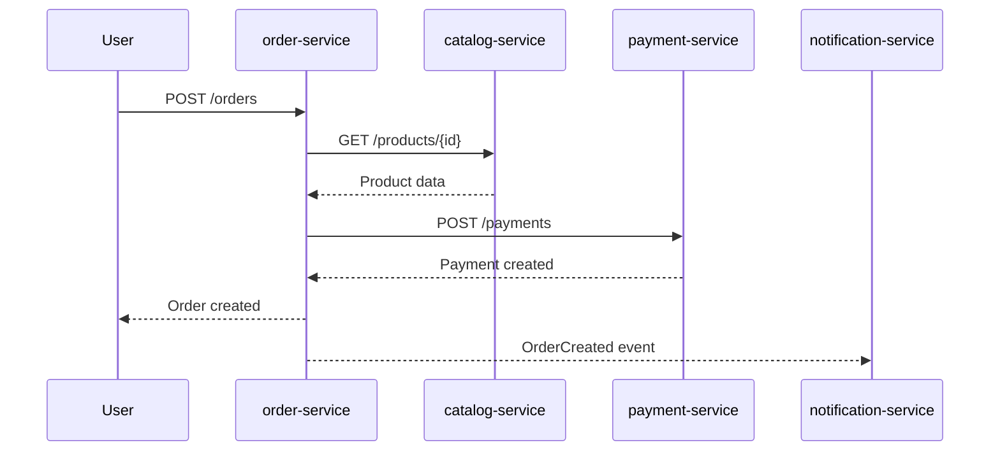
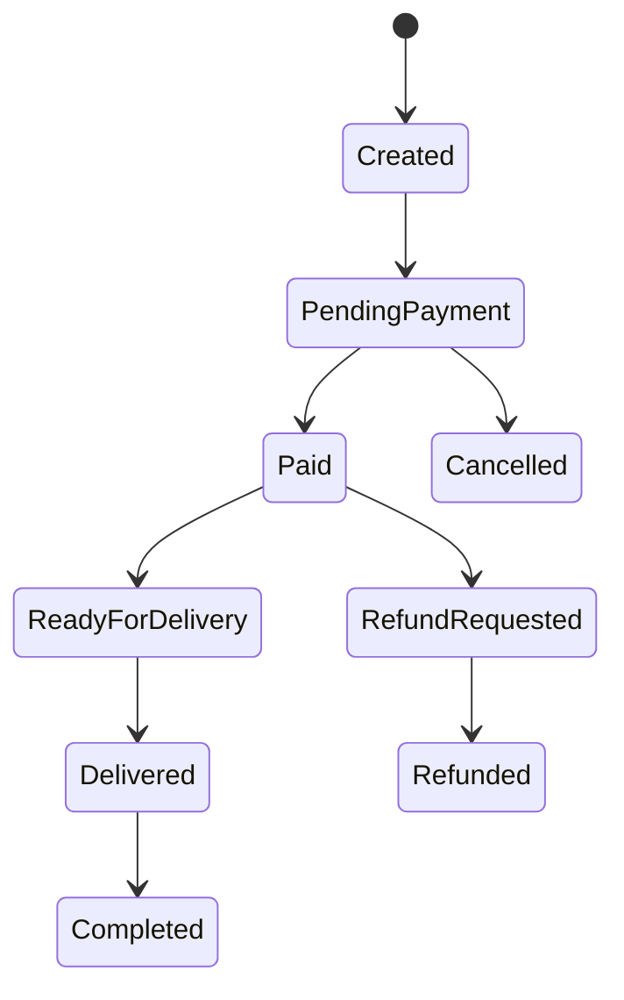

# Лекція. Контракти та сценарії взаємодії у мікросервісних системах

## Дисципліна

**Інженерія змін у мікросервісних системах**

## Тема лекції

**Контракти, сценарії взаємодії та еволюція поведінки мікросервісної системи**

---

## 1. Вступ: чому тема контрактів важлива

Мікросервісна система складається не просто з набору окремих програмних компонентів. Її головна складність виникає на межах між цими компонентами: у способах виклику, передачі даних, обміну подіями, узгодження станів і підтримки сумісності між різними версіями сервісів.

У монолітному застосунку взаємодія між модулями часто прихована всередині одного процесу. Один модуль може викликати метод іншого модуля напряму, використовувати спільні структури даних або звертатися до тієї самої бази даних. У мікросервісній архітектурі така взаємодія стає зовнішньою: сервіси спілкуються через HTTP API, брокери повідомлень, події, черги, зовнішні інтеграції або спеціалізовані протоколи.

Це означає, що кожна взаємодія між сервісами повинна бути описана, зрозуміла і контрольована. Якщо цього не зробити, система швидко перетворюється на набір неявних залежностей, у якому будь-яка невелика зміна може мати непередбачувані наслідки.

У цій лекції розглядаються три пов’язані поняття:

1. **Контракт** — формалізована домовленість про спосіб взаємодії між сервісами.
2. **Сценарій взаємодії** — послідовність дій і повідомлень між компонентами системи.
3. **Еволюція взаємодій** — зміна контрактів і сценаріїв у процесі розвитку системи.

Основна ідея лекції полягає в тому, що в мікросервісних системах важливо документувати не лише структуру системи, а й її поведінку.

---

## 2. Від модулів до сервісів: як змінилася проблема інтеграції

Історично багато інформаційних систем створювалися як монолітні застосунки. У такій архітектурі бізнес-логіка, інтерфейс, доступ до даних та інтеграції часто розміщувалися в одному великому програмному продукті. Такий підхід мав очевидні переваги: простіший запуск, простіше локальне тестування, єдина кодова база, спільна база даних.

Однак зі зростанням системи виникали типові проблеми:

- складність внесення змін;
- важкість розуміння залежностей між частинами системи;
- ризик регресій при зміні невеликого фрагмента коду;
- довгі релізні цикли;
- неможливість незалежного масштабування окремих частин;
- організаційна залежність між командами.

Мікросервісний підхід запропонував іншу ідею: розбити велику систему на набір невеликих сервісів, кожен із яких відповідає за окрему бізнес-можливість. Це дозволяє командам розробляти, тестувати, розгортати й масштабувати сервіси більш незалежно.

Але незалежність має ціну. Якщо раніше один модуль викликав інший метод усередині одного застосунку, то тепер один сервіс звертається до іншого через мережу. Мережевий виклик має затримку, може завершитися помилкою, може бути недоступним, може повернути дані в іншому форматі або від іншої версії сервісу.

Тому в мікросервісній архітектурі питання інтеграції стає центральним. Система працює коректно не тому, що в ній є багато сервісів, а тому, що взаємодія між ними організована зрозуміло й передбачувано.

---

## 3. Поняття контракту в програмній інженерії

У загальному сенсі контракт — це домовленість між двома сторонами. У програмній інженерії контракт визначає, що один компонент очікує від іншого.

У мікросервісній системі контракт може описувати:

- які операції доступні;
- які параметри потрібно передати;
- які дані буде повернуто;
- які помилки можливі;
- які події можуть бути опубліковані;
- який формат має повідомлення;
- які стани може мати бізнес-об’єкт;
- які гарантії надає сервіс;
- які обмеження повинен врахувати клієнт.

Наприклад, якщо `order-service` викликає `payment-service`, між ними існує контракт. Він може бути формальним або неформальним.

Неформальний контракт:

> Для створення платежу потрібно передати ідентифікатор замовлення і суму. Сервіс поверне статус платежу.

Формальний контракт:

```http
POST /payments
Content-Type: application/json
```

```json
{
  "orderId": "ord-1001",
  "amount": 1200.50,
  "currency": "UAH"
}
```

```json
{
  "paymentId": "pay-9001",
  "status": "PENDING"
}
```

Другий варіант значно корисніший, тому що його можна перевіряти, документувати, використовувати для тестування, генерації клієнтів або узгодження роботи між командами.

Контракт — це не просто опис API. Це спосіб зробити залежність між сервісами явною.

---

## 4. Контракт як межа відповідальності

Один із найважливіших принципів мікросервісної архітектури полягає в тому, що сервіс приховує свою внутрішню реалізацію. Інші сервіси не повинні знати, як саме він зберігає дані, які таблиці використовує, як організовано його внутрішній код або які приватні правила він має.

Інші сервіси повинні знати тільки контракт.

Наприклад, `payment-service` може зберігати платежі в PostgreSQL, MongoDB або зовнішній платіжній системі. Для `order-service` це не має значення. Йому важливо знати, як створити платіж і як отримати результат.

Саме тому контракт виконує роль межі відповідальності:

- сервіс сам відповідає за свою реалізацію;
- клієнти сервісу покладаються лише на публічний контракт;
- зміни всередині сервісу не повинні ламати інших учасників системи;
- зміни контракту мають бути керованими.

Якщо інші сервіси починають напряму читати базу даних сервісу або використовувати його внутрішні формати, межа відповідальності руйнується. Така система може формально називатися мікросервісною, але фактично вона поводиться як розподілений моноліт.

---

## 5. Типи контрактів у мікросервісних системах

У мікросервісній системі існує кілька типів контрактів. Найчастіше студенти одразу думають про REST API, але це лише один із варіантів.

### 5.1. HTTP API контракт

HTTP API контракт описує синхронну взаємодію між клієнтом і сервісом. Зазвичай такий контракт містить:

- HTTP-метод;
- URL;
- параметри шляху;
- query-параметри;
- тіло запиту;
- формат відповіді;
- коди помилок;
- вимоги до авторизації.

Приклад:

```http
GET /orders/{orderId}
```

Можлива відповідь:

```json
{
  "orderId": "ord-1001",
  "status": "PAID",
  "totalAmount": 1200.50,
  "currency": "UAH"
}
```

HTTP API зручний тоді, коли клієнт очікує відповідь одразу. Але синхронні виклики збільшують зв’язність сервісів. Якщо один сервіс недоступний, інший може також не виконати операцію.

### 5.2. Event contract

Event contract описує асинхронну подію, яку один сервіс публікує, а інші сервіси можуть споживати.

Приклад події:

```json
{
  "eventName": "OrderCreated",
  "version": "1.0",
  "orderId": "ord-1001",
  "userId": "usr-501",
  "totalAmount": 1200.50,
  "currency": "UAH",
  "occurredAt": "2026-09-22T10:00:00Z"
}
```

Подія не є просто технічним повідомленням. Вона фіксує факт, який уже відбувся в системі. Наприклад, `OrderCreated` означає, що замовлення створено. Інші сервіси можуть реагувати на цей факт: надіслати повідомлення, зарезервувати товар, створити доставку або запустити оплату.

Подієві контракти особливо важливі для процесних змін. Якщо змінюється бізнес-процес, часто змінюється не один endpoint, а послідовність подій, які виникають у системі.

### 5.3. Data contract

Data contract описує структуру даних, яку один сервіс надає іншому. Це може бути схема DTO, формат файлу, структура повідомлення, структура експорту або модель даних у спільному аналітичному сховищі.

У мікросервісній архітектурі небажано, щоб сервіси напряму працювали з чужими таблицями. Проте дані все одно передаються між сервісами через API, події або інтеграційні потоки. Тому структура цих даних також є контрактом.

### 5.4. Process contract

Process contract описує не один виклик, а очікувану послідовність дій між сервісами.

Наприклад, процес повернення товару може містити такі кроки:

1. Користувач створює запит на повернення.
2. Система перевіряє, чи дозволене повернення.
3. Оператор підтверджує повернення.
4. Сервіс доставки організовує отримання товару.
5. Після перевірки товару запускається повернення коштів.
6. Користувач отримує повідомлення.

У такому випадку головний контракт — це не лише `POST /returns`. Головний контракт — це узгоджений процес, стани повернення, події між сервісами й правила переходу між станами.

### 5.5. Error contract

Помилки також є частиною контракту.

Поганий підхід:

```json
{
  "error": "Something went wrong"
}
```

Кращий підхід:

```json
{
  "code": "PROMO_CODE_EXPIRED",
  "message": "Promo code has expired",
  "details": {
    "promoCode": "SALE10"
  }
}
```

Якщо клієнт сервісу не знає, які помилки можуть виникнути, він не може коректно обробити негативні сценарії. Тому помилки потрібно описувати так само уважно, як успішні відповіді.

---

## 6. OpenAPI: історичний контекст і призначення

Одним із найпоширеніших стандартів опису HTTP API є OpenAPI Specification. Вона визначає стандартний, незалежний від мови програмування спосіб опису HTTP API, завдяки якому люди й програмні інструменти можуть зрозуміти можливості сервісу без доступу до його коду або додаткової документації.

Історично OpenAPI виросла зі Swagger Specification. Swagger з’явився на початку 2010-х років як спосіб описувати REST API і генерувати з такого опису документацію та допоміжні інструменти. У 2015 році було створено Open API Initiative під егідою Linux Foundation, а SmartBear передала Swagger Specification до цієї ініціативи. Після цього специфікація стала розвиватися як vendor-neutral стандарт під назвою OpenAPI.

Цей історичний перехід важливий не лише як факт. Він показує зміну ставлення до API. API перестав бути просто набором endpoint-ів у коді. Він став публічним інтерфейсом, який потрібно проєктувати, описувати, обговорювати, версіонувати й підтримувати.

У сучасній розробці OpenAPI може використовуватися для:

- документування API;
- узгодження контракту між командами;
- генерації клієнтського коду;
- генерації серверних заглушок;
- валідації запитів і відповідей;
- contract testing;
- аналізу breaking changes;
- створення mock-серверів;
- навчання нових розробників.

Однак важливо розуміти обмеження OpenAPI. Вона добре описує HTTP API, але не описує всю поведінку системи. Для процесів, подій, станів і асинхронної взаємодії потрібні додаткові моделі.

---

## 7. Contract-first і code-first підходи

Під час роботи з API часто виділяють два підходи: code-first і contract-first.

### 7.1. Code-first

У code-first підході розробник спочатку пише код сервісу, а документація API генерується на основі цього коду.

Переваги:

- швидкий старт;
- зручно для невеликих команд;
- менше ручної роботи на початку;
- документація може автоматично оновлюватися.

Недоліки:

- API може відображати внутрішню структуру коду, а не потреби споживачів;
- контракт часто з’являється занадто пізно;
- складніше узгоджувати зміни між командами до реалізації;
- є ризик, що API стане випадковим результатом реалізації.

### 7.2. Contract-first

У contract-first підході команда спочатку описує контракт API, погоджує його зі споживачами, а вже потім реалізує сервіс.

Переваги:

- контракт можна обговорити до написання коду;
- різні команди можуть працювати паралельно;
- можна створити mock API;
- легше виявити breaking changes;
- API проєктується з погляду користувача.

Недоліки:

- потрібна дисципліна підтримки контракту;
- треба вміти проєктувати API до реалізації;
- можливе розходження між контрактом і кодом, якщо немає автоматичних перевірок.

Для дисципліни «Інженерія змін у мікросервісних системах» особливо важливий саме contract-first підхід, тому що зміна має бути осмислена до реалізації. Студент повинен навчитися відповідати на питання:

> Що саме зміниться в контракті, кого це зачепить і чи збережеться сумісність?

---

## 8. API як продукт і як соціальна домовленість

API часто розглядають як технічний інтерфейс. Але у великих системах API є також організаційною домовленістю між командами.

Якщо одна команда розробляє `payment-service`, а інша команда розробляє `order-service`, то контракт між цими сервісами є способом координації між командами. Зміна API без погодження може порушити роботу іншої команди так само, як зміна умов договору без попередження.

Тому API має властивості продукту:

- у нього є споживачі;
- у нього є очікувана поведінка;
- у нього є документація;
- у нього є версії;
- у нього є життєвий цикл;
- у нього можуть бути застарілі частини;
- у нього є політика підтримки.

У внутрішніх мікросервісних системах цю ідею часто недооцінюють. Розробники можуть думати: «Це ж наш внутрішній endpoint, ми можемо змінити його як завгодно». Але саме такі неконтрольовані зміни часто створюють найбільші проблеми.

Навіть внутрішній API є контрактом. Якщо його використовують інші сервіси, його потрібно змінювати обережно.

---

## 9. Сумісність контрактів

Ключове питання при зміні контракту:

> Чи зможуть старі клієнти працювати з новою версією сервісу?

Якщо так, зміна зазвичай вважається backward-compatible. Якщо ні, зміна є breaking change.

### 9.1. Приклади сумісних змін

Зазвичай сумісними можуть бути:

- додавання нового необов’язкового поля у відповідь;
- додавання нового необов’язкового query-параметра;
- додавання нового endpoint-а;
- розширення списку значень, якщо клієнти готові до невідомих значень;
- додавання нової події без зміни старої.

Приклад:

Було:

```json
{
  "orderId": "ord-1001",
  "status": "PAID"
}
```

Стало:

```json
{
  "orderId": "ord-1001",
  "status": "PAID",
  "discountAmount": 100.00
}
```

Якщо старі клієнти ігнорують невідомі поля, така зміна зазвичай безпечна.

### 9.2. Приклади несумісних змін

Breaking changes:

- перейменування поля;
- видалення поля;
- зміна типу поля;
- перетворення необов’язкового поля на обов’язкове;
- зміна семантики існуючого поля;
- зміна структури помилки;
- зміна значень статусів без підтримки старих;
- зміна поведінки endpoint-а без зміни його контракту.

Приклад:

Було:

```json
{
  "amount": 1200.50
}
```

Стало:

```json
{
  "amount": "1200.50 UAH"
}
```

Формально поле залишилося з тією самою назвою, але його тип і семантика змінилися. Це може зламати клієнтів.

### 9.3. Семантична несумісність

Найнебезпечніші зміни — це не завжди ті, які видно в схемі.

Наприклад, endpoint `POST /orders` раніше створював замовлення одразу в статусі `CREATED`, а після зміни створює його в статусі `PENDING_APPROVAL`. Формат відповіді може залишитися тим самим, але поведінка системи змінилася.

Це називається семантичною зміною. Вона особливо важлива при зміні бізнес-процесів.

---

## 10. Сценарії взаємодії: навіщо описувати поведінку

Контракт окремого API або події не завжди достатній для розуміння системи. У мікросервісах важливо знати не лише «який endpoint існує», а й «коли, ким і в якій послідовності він викликається».

Сценарій взаємодії описує поведінку системи в часі.

Наприклад, процес оформлення замовлення може виглядати так:

1. Користувач створює замовлення.
2. `order-service` перевіряє товари через `catalog-service`.
3. `order-service` створює запис замовлення.
4. `payment-service` створює платіж.
5. Після успішної оплати публікується подія `PaymentCompleted`.
6. `order-service` змінює статус замовлення.
7. `notification-service` надсилає повідомлення.
8. `delivery-service` готує доставку.

Цей опис показує те, чого не видно з одного OpenAPI-файлу: залежності, послідовність, точки відмови, асинхронні події, зміни станів.

Для опису сценаріїв часто використовують:

- текстовий сценарій;
- sequence diagram;
- BPMN-подібну схему;
- state diagram;
- таблицю переходів станів.

---

## 11. AS-IS і TO-BE моделі

При аналізі змін важливо розділяти поточний і майбутній стан системи.

**AS-IS** — це модель того, як система працює зараз.

**TO-BE** — це модель того, як система має працювати після зміни.

Це розділення допомагає уникнути плутанини. Студенти часто одразу описують бажану поведінку, але не фіксують початковий стан. У результаті важко зрозуміти, що саме змінилося.

Приклад:

AS-IS:

- користувач створює замовлення;
- система одразу переходить до оплати;
- після оплати замовлення передається на доставку.

TO-BE:

- користувач створює замовлення;
- система перевіряє промокод;
- система перераховує суму;
- користувач переходить до оплати зі знижкою;
- після оплати замовлення передається на доставку.

У такій формі видно, що зміна стосується не лише API, а й бізнес-логіки, даних, перевірок, платежу й повідомлень.

---

## 12. Sequence diagram як спосіб показати взаємодію

Sequence diagram показує, як учасники системи взаємодіють у часі. Вона особливо корисна для мікросервісів, тому що дозволяє побачити ланцюжок викликів.

Приклад у Mermaid:



На такій діаграмі можна побачити:

- які сервіси беруть участь у процесі;
- які виклики є синхронними;
- де є асинхронні події;
- які сервіси можуть вплинути на час відповіді;
- де потенційні точки відмови.

Якщо для одного користувацького запиту виникає занадто довгий синхронний ланцюжок, це може бути архітектурною проблемою. Наприклад, якщо `order-service` синхронно викликає п’ять інших сервісів, то недоступність одного з них може зламати весь сценарій.

---

## 13. State diagram і життєвий цикл бізнес-сутності

Багато бізнес-процесів у мікросервісних системах пов’язані зі зміною стану певної сутності.

Приклади сутностей:

- замовлення;
- платіж;
- повернення товару;
- заявка підтримки;
- бронювання;
- доставка;
- підписка.

Для таких сутностей важливо описати можливі стани й переходи між ними.

Приклад станів замовлення:



State diagram дозволяє побачити:

- які стани можливі;
- які переходи дозволені;
- які переходи заборонені;
- які стани додаються при зміні бізнес-процесу;
- які сервіси відповідають за зміну станів.

Це особливо важливо, коли зміна стосується бізнес-процесу, а не лише API.

Наприклад, додавання процесу повернення товару може потребувати нових станів:

- `ReturnRequested`;
- `ReturnApproved`;
- `ReturnRejected`;
- `RefundInProgress`;
- `Refunded`.

Якщо ці стани не описати, команда може реалізувати процес неповно або суперечливо.

---

## 14. Події як відображення бізнес-фактів

Подія в мікросервісній системі повинна описувати факт, який уже відбувся.

Добрі назви подій:

- `OrderCreated`;
- `PaymentCompleted`;
- `ReturnRequested`;
- `DeliveryAssigned`;
- `UserRegistered`.

Гірші назви:

- `CreateOrderCommand`;
- `DoPayment`;
- `SendNotification`.

Різниця полягає в тому, що подія не наказує іншому сервісу щось зробити. Вона повідомляє про факт. Інші сервіси самі вирішують, як реагувати.

Це зменшує зв’язність між сервісами.

Наприклад, якщо `order-service` після створення замовлення напряму викликає `notification-service`, `delivery-service` і `analytics-service`, він знає занадто багато про інших учасників системи.

Інший підхід:

1. `order-service` створює замовлення.
2. `order-service` публікує `OrderCreated`.
3. `notification-service` реагує і надсилає повідомлення.
4. `delivery-service` реагує і готує доставку.
5. `analytics-service` реагує і оновлює аналітику.

У такій моделі `order-service` не повинен знати всіх споживачів події.

---

## 15. Подія, команда і запит

У мікросервісах важливо розрізняти три типи повідомлень.

### 15.1. Query

Запит на отримання даних.

Приклад:

```http
GET /products/{productId}
```

Запит не повинен змінювати стан системи.

### 15.2. Command

Команда просить систему виконати дію.

Приклад:

```http
POST /payments
```

Або повідомлення:

```json
{
  "commandName": "CreatePayment",
  "orderId": "ord-1001",
  "amount": 1200.50
}
```

Команда може бути відхилена.

### 15.3. Event

Подія повідомляє про те, що щось уже сталося.

Приклад:

```json
{
  "eventName": "PaymentCompleted",
  "paymentId": "pay-9001",
  "orderId": "ord-1001"
}
```

Подію не можна «відхилити», тому що факт уже відбувся. Споживач може не обробити її, але це вже інша проблема.

Розрізнення command/query/event допомагає краще проєктувати взаємодію між сервісами.

---

## 16. Версіонування контрактів

Контракти змінюються разом із системою. Тому потрібно мати стратегію версіонування.

### 16.1. Версіонування HTTP API

Поширені варіанти:

```text
/api/v1/orders
/api/v2/orders
```

або через заголовки:

```http
Accept: application/vnd.company.orders.v2+json
```

Версія в URL простіша для навчальних прикладів і зрозуміла студентам. Версія в заголовках може бути гнучкішою, але складнішою для підтримки.

### 16.2. Версіонування подій

Події також мають версії.

```json
{
  "eventName": "OrderCreated",
  "version": "1.0",
  "payload": {
    "orderId": "ord-1001"
  }
}
```

При зміні payload потрібно розуміти, чи старі споживачі зможуть прочитати нову подію.

### 16.3. Паралельне існування версій

У мікросервісній системі стара й нова версії контракту можуть існувати одночасно. Це нормальна ситуація, тому що всі сервіси не завжди оновлюються одночасно.

Саме тому небезпечно робити зміну, яка вимагає миттєвого оновлення всіх споживачів.

---

## 17. Deprecation policy

Якщо старий API або стара подія більше не рекомендовані до використання, їх не варто просто видаляти. Потрібна deprecation policy — політика поступового виведення з використання.

Вона може містити:

- дату оголошення застарілого контракту;
- причину зміни;
- нову рекомендовану версію;
- період підтримки старої версії;
- дату можливого видалення;
- список відомих споживачів;
- план міграції.

Наприклад:

> Endpoint `POST /v1/orders` позначено як deprecated з 01.10.2026. Нова версія `POST /v2/orders` підтримує промокоди й розширену модель доставки. Версія v1 підтримується до 01.12.2026.

Таке повідомлення дозволяє іншим командам планувати перехід.

---

## 18. Contract testing

Contract testing — це підхід до тестування, у якому перевіряється, чи сервіс дотримується свого контракту.

У мікросервісних системах проблема полягає в тому, що один сервіс може змінитися й випадково зламати інших споживачів. Повні end-to-end тести часто дорогі, повільні й нестабільні. Contract testing дозволяє перевірити сумісність на межі між сервісами.

Існує кілька підходів:

- перевірка відповідності реалізації OpenAPI-специфікації;
- consumer-driven contract testing;
- schema validation для подій;
- тестування mock-сервера;
- перевірка backward compatibility між версіями контракту.

Ідея consumer-driven contracts полягає в тому, що споживачі описують свої очікування від провайдера. Провайдер потім перевіряє, чи не порушив ці очікування.

У контексті інженерії змін contract testing відповідає на питання:

> Чи зламала наша зміна тих, хто вже використовує цей сервіс?

---

## 19. Сценарії негативних випадків

При описі контрактів і сценаріїв студенти часто фокусуються лише на успішному сценарії. Але реальна система повинна поводитися передбачувано і при помилках.

Для кожного важливого сценарію потрібно думати про негативні випадки:

- товар недоступний;
- користувач не має прав;
- платіж відхилено;
- промокод недійсний;
- доставка недоступна;
- зовнішній сервіс не відповідає;
- подія доставлена повторно;
- подія оброблена із затримкою;
- один сервіс оновлено, інший ще ні.

Негативні сценарії часто показують справжню складність системи.

Наприклад, процес повернення товару може виглядати просто, доки не виникають питання:

- що робити, якщо товар не повернувся на склад;
- що робити, якщо повернення коштів не вдалося;
- що робити, якщо клієнт скасував заявку;
- що робити, якщо доставка втратила товар;
- що робити, якщо подія `ReturnApproved` була оброблена двічі.

Саме такі сценарії відрізняють поверхневий опис від інженерного аналізу.

---

## 20. Ідемпотентність

Ідемпотентність означає, що повторне виконання тієї самої операції не змінює результат після першого успішного виконання.

У розподілених системах це дуже важливо, тому що повідомлення можуть дублюватися, клієнт може повторити запит після timeout, а брокер може доставити подію більше одного разу.

Приклад проблеми:

1. Користувач натискає «Оплатити».
2. `payment-service` створює платіж.
3. Відповідь втрачається через мережеву помилку.
4. Клієнт повторює запит.
5. Система створює другий платіж.

Щоб уникнути цього, можна використовувати idempotency key:

```http
POST /payments
Idempotency-Key: 9f5a1d2e-7c1b-4e5a-9c2a-001
```

Сервіс запам’ятовує, що запит із таким ключем уже був оброблений, і не створює дубль.

Ідемпотентність особливо важлива для платежів, замовлень, повернень, списання коштів і будь-яких операцій із побічними ефектами.

---

## 21. Узгодженість у часі та eventual consistency

У монолітній системі часто очікується, що після завершення операції всі дані одразу узгоджені. У мікросервісній системі це не завжди можливо або доцільно.

Наприклад:

1. `order-service` створив замовлення.
2. `payment-service` ще обробляє платіж.
3. `delivery-service` ще не отримав подію.
4. `notification-service` ще не надіслав повідомлення.

У певний момент різні сервіси можуть бачити різні частини стану. Це називається eventual consistency — узгодженість, яка досягається з часом.

Це не помилка сама по собі. Але її потрібно враховувати в сценаріях і контрактах.

Погано:

> Після створення замовлення всі сервіси миттєво знають його новий стан.

Краще:

> Після створення замовлення `order-service` публікує подію `OrderCreated`. Інші сервіси обробляють її асинхронно. До завершення обробки подій статуси в різних сервісах можуть тимчасово відрізнятися.

---

## 22. Контракти і зміна бізнес-процесу

Важливо розуміти, що не кожна суттєва зміна системи виглядає як велика зміна API.

Наприклад, додавання процесу погодження замовлення менеджером може потребувати лише кількох нових endpoint-ів:

```http
POST /orders/{id}/approve
POST /orders/{id}/reject
```

Але на рівні системи змінюється значно більше:

- з’являється новий стан замовлення;
- змінюється момент запуску оплати;
- змінюється логіка повідомлень;
- змінюється логіка доставки;
- з’являються нові ролі користувачів;
- змінюються правила тестування;
- змінюється моніторинг бізнес-процесу.

Тому при аналізі змін не можна зводити все до OpenAPI. OpenAPI показує тільки частину зміни. Повна картина виникає тоді, коли API-контракти поєднуються зі сценаріями, подіями та станами.

---

## 23. Приклад: процес повернення товару

Розглянемо приклад зміни: система онлайн-замовлень повинна підтримувати повернення товару.

### 23.1. AS-IS

До зміни система підтримує тільки базовий життєвий цикл замовлення:

```text
Created -> Paid -> Delivered -> Completed
```

Після доставки замовлення вважається завершеним.

### 23.2. TO-BE

Після зміни користувач може ініціювати повернення:

```text
Delivered -> ReturnRequested -> ReturnApproved -> RefundInProgress -> Refunded
```

### 23.3. Нові контракти

HTTP API:

```http
POST /returns
GET /returns/{returnId}
POST /returns/{returnId}/approve
POST /returns/{returnId}/reject
```

Події:

```text
ReturnRequested
ReturnApproved
ReturnRejected
RefundStarted
RefundCompleted
```

### 23.4. Зачеплені сервіси

- `order-service` — повинен знати, що замовлення може перейти в процес повернення;
- `return-service` — новий або окремий сервіс для керування поверненнями;
- `payment-service` — відповідає за refund;
- `delivery-service` — організовує повернення товару;
- `notification-service` — повідомляє користувача;
- `inventory-service` — повертає товар на склад.

### 23.5. Основний висновок

На рівні API зміна може виглядати невеликою. Але на рівні сценарію вона зачіпає багато сервісів, стани, події й ризики. Саме тому потрібна модель взаємодії, а не тільки список endpoint-ів.

---

## 24. Типові помилки при описі контрактів і сценаріїв

### Помилка 1. Описувати тільки успішний сценарій

Система має працювати не лише тоді, коли все добре. Потрібно описувати помилки, відмови й альтернативні гілки.

### Помилка 2. Плутати подію і команду

`PaymentCompleted` — це подія.  
`CreatePayment` — це команда.

Якщо назви змішані, важко зрозуміти відповідальність сервісів.

### Помилка 3. Не вказувати власника стану

Якщо незрозуміло, хто змінює статус замовлення, у системі швидко виникають конфлікти.

### Помилка 4. Описувати API без споживачів

Endpoint сам по собі не пояснює, хто його використовує і навіщо.

### Помилка 5. Не описувати помилки

Коди помилок і структура error response є частиною контракту.

### Помилка 6. Вважати, що додавання поля завжди безпечне

Додавання поля зазвичай безпечне лише тоді, коли клієнти готові ігнорувати невідомі поля.

### Помилка 7. Не відрізняти формат від семантики

Можна не змінити JSON-схему, але змінити поведінку системи так, що клієнти все одно зламаються.

---

## 25. Які питання потрібно ставити перед зміною контракту

Перед зміною API, події або бізнес-сценарію потрібно відповісти на такі питання:

1. Хто є споживачем цього контракту?
2. Чи знаємо ми всіх споживачів?
3. Чи є зміна backward-compatible?
4. Чи змінюється семантика існуючих полів?
5. Чи потрібно підтримувати стару версію?
6. Чи потрібна deprecation policy?
7. Чи змінюються стани бізнес-сутності?
8. Чи змінюється порядок взаємодії сервісів?
9. Чи потрібно додати нові події?
10. Чи потрібно змінити тести?
11. Чи є ризик дублювання повідомлень?
12. Чи потрібна ідемпотентність?
13. Що буде при частковій відмові одного сервісу?
14. Як ми зрозуміємо після релізу, що зміна працює правильно?

Ці питання переводять обговорення з рівня «додамо endpoint» на рівень інженерного аналізу зміни.

---

## 26. Зв’язок контрактів із подальшим аналізом системи

Контракти та сценарії взаємодії потрібні не лише для документації. Вони є основою для наступних видів аналізу:

- побудови графа залежностей;
- визначення affected services;
- impact analysis;
- contract testing;
- планування релізу;
- оцінки ризиків;
- побудови тестової стратегії;
- планування rollback або roll-forward;
- моніторингу після впровадження зміни.

Наприклад, якщо в OpenAPI видно, що `order-service` викликає `payment-service`, а в event contract видно, що `payment-service` публікує `PaymentCompleted`, ці зв’язки можна перетворити на ребра графа залежностей.

Якщо TO-BE сценарій показує новий стан `RefundInProgress`, це означає, що потрібно перевірити всі сервіси, які працюють зі статусом замовлення або платежу.

Таким чином, контракти й сценарії є не кінцевою документацією, а вхідними даними для інженерного керування змінами.

---

## 27. Підсумки лекції

У мікросервісній системі складність виникає не лише всередині окремих сервісів, а й на межах між ними. Тому контракти взаємодії мають бути явними, зрозумілими й керованими.

OpenAPI є важливим інструментом для опису HTTP API, але він не покриває всю поведінку системи. Для повного розуміння змін потрібно також описувати події, сценарії, стани бізнес-сутностей, негативні випадки й правила еволюції контрактів.

Особливо важливо пам’ятати, що зміна може бути не API-орієнтованою, а процесною, подієвою або data-oriented. У такому випадку основна складність може бути не в endpoint-ах, а в нових станах, переходах, подіях, правилах узгодженості та взаємодії сервісів.

Головна думка лекції:

> У мікросервісній системі контракт — це не просто технічна документація. Це інженерний механізм керування змінами.

---

## 28. Контрольні питання для самоперевірки

1. Чому в мікросервісній системі контракт важливіший, ніж у моноліті?
2. Які типи контрактів можуть існувати між сервісами?
3. Чим event contract відрізняється від HTTP API contract?
4. Чому помилки є частиною контракту?
5. Що таке backward-compatible зміна?
6. Наведіть приклад breaking change.
7. Чому зміна поведінки може бути небезпечнішою за зміну структури JSON?
8. Для чого потрібні AS-IS і TO-BE моделі?
9. Коли варто використовувати sequence diagram?
10. Для чого потрібна state diagram?
11. Чим команда відрізняється від події?
12. Що таке deprecation policy?
13. Для чого потрібне contract testing?
14. Чому OpenAPI не достатньо для опису зміни бізнес-процесу?
15. Як контракти допомагають у подальшому impact analysis?

---

## 29. Рекомендовані безкоштовні інструменти

- **Swagger Editor** — редагування та перевірка OpenAPI-специфікацій.
- **Swagger UI** — перегляд API-документації.
- **Redoc** — генерація зручної документації з OpenAPI.
- **Mermaid** — опис sequence diagram і state diagram у Markdown.
- **PlantUML** — побудова UML-діаграм.
- **Stoplight Studio Community** — візуальна робота з API-контрактами.
- **OpenAPI Generator** — генерація клієнтів і серверних заглушок.
- **Prism** — mock-сервер для OpenAPI.

---

## 30. Джерела та додаткове читання

1. OpenAPI Specification v3.1.1.  
   https://spec.openapis.org/oas/v3.1.1.html

2. OpenAPI Initiative FAQ.  
   https://www.openapis.org/faq

3. Linux Foundation. New Collaborative Project to Extend Swagger Specification for Building Connected Applications and Services.  
   https://www.linuxfoundation.org/press/press-release/new-collaborative-project-to-extend-swagger-specification-for-building-connected-applications-and-services

4. OpenAPI Initiative. A Short History of the OpenAPI Initiative and the OpenAPI Specification.  
   https://www.openapis.org/style-guide

5. Martin Fowler. Consumer-Driven Contracts.  
   https://martinfowler.com/articles/consumerDrivenContracts.html

6. Mermaid Documentation. Sequence diagrams and state diagrams.  
   https://mermaid.js.org/

